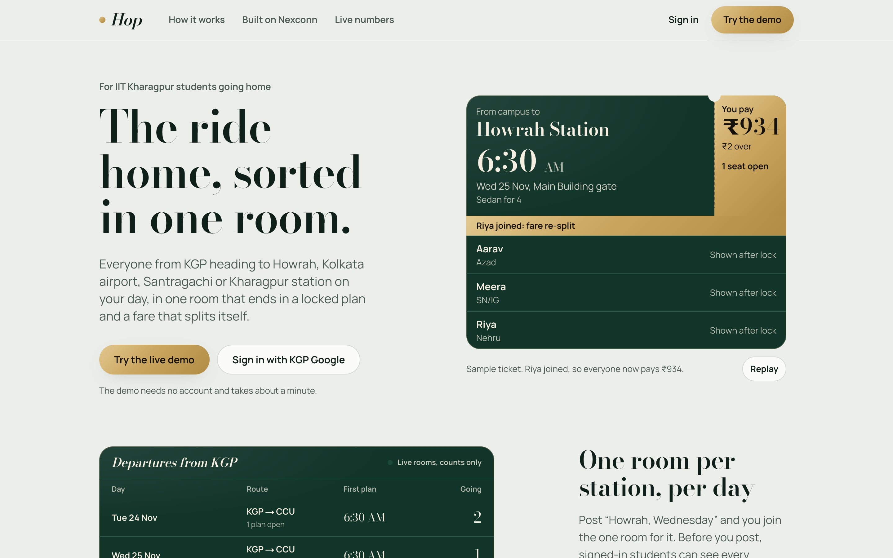
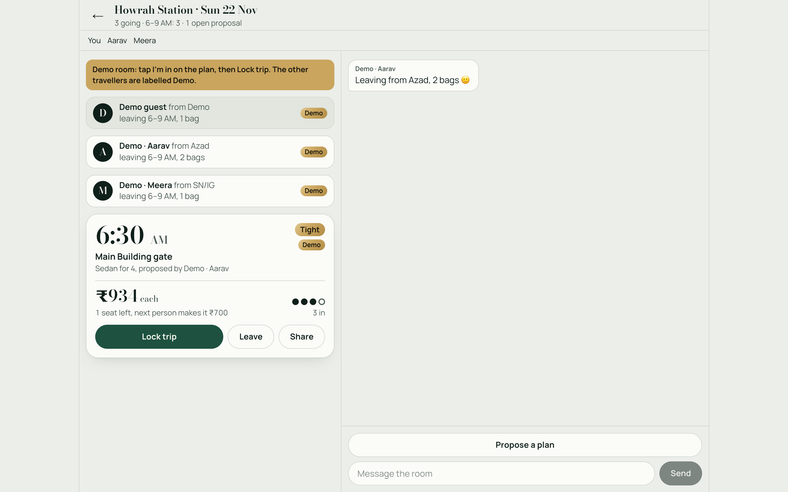
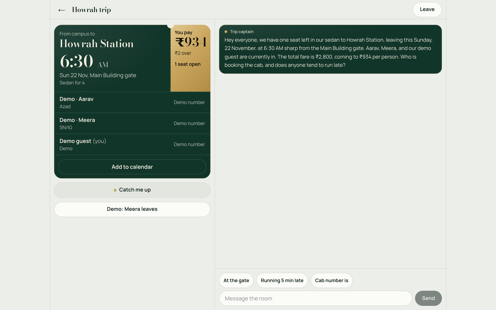

# Hop: the ride home, sorted in one room

**Live:** https://hop-kgp.vercel.app · **Guided demo (no account):** https://hop-kgp.vercel.app/demo · **Track:** Social & Community · Built for the [Nexconn Build Challenge 2026](https://reskilll.com/hack/nexconn)

At the end of every semester, IIT Kharagpur students hunt for people to share a cab or toto to Howrah, Kolkata airport, Santragachi or Kharagpur station. Today that happens in buried WhatsApp posts that expose phone numbers and never show who has really committed.

Hop turns it into a chat that **ends in a decision**:

1. Post where and when you're going. You land in the one room for that station and day (a Nexconn group channel).
2. Someone proposes a plan (time, meeting point, vehicle, fare). The per-head fare drops on every phone as people tap **I'm in** (custom message cards plus message metadata).
3. With at least two in, anyone in the plan can **lock** it. The room hands you a private trip with a **Trip Ticket**: numbers revealed, fare split, free seats still open. Joins and leaves re-split the fare for everyone.
4. **Catch me up** streams an AI summary of the plan and chat into the trip (Gemini over a Nexconn streaming message).



| A room on a laptop (3 in, ₹934 each) | The locked trip with the AI trip captain |
|---|---|
|  |  |

**Judges:** open **[/demo](https://hop-kgp.vercel.app/demo)**. It runs the real app beside step-by-step instructions, in a sandbox with two labelled sample travellers. Demo guests are server-flagged, their Nexconn IDs start with `demo`, they never touch real rooms, and they are excluded from every public number ([/stats](https://hop-kgp.vercel.app/stats)).

### The website

| Page | What it's for |
|---|---|
| [`/`](https://hop-kgp.vercel.app) | The story: the problem, a live departures board (real rooms, counts only), the four steps, what's new, how to try it |
| [`/how-it-works`](https://hop-kgp.vercel.app/how-it-works) | Each step with the real components, fares, privacy, safety, FAQ |
| [`/built-on-nexconn`](https://hop-kgp.vercel.app/built-on-nexconn) | Architecture, one-tap end-to-end flow, every SDK feature with code links, trust model, honest limits |
| [`/demo`](https://hop-kgp.vercel.app/demo) | Guided demo with the live product embedded |
| [`/stats`](https://hop-kgp.vercel.app/stats) | Live real numbers (demo excluded) and the plan beyond KGP |
| `/home`, `/departures`, `/account`, `/l/[id]`, `/pod/[id]` | The product: trips, the board, profile, rooms and trips (two-pane on desktop, one column on phones) |

## Nexconn SDK features used

| Feature | Where | Why |
|---|---|---|
| Init, connect, token auth (`NCEngine.initialize`, `connect`) | [`web/src/client/nexconn.ts`](web/src/client/nexconn.ts) (client), [`web/src/server/nexconn/api.ts`](web/src/server/nexconn/api.ts) `issueToken` + [`web/src/app/api/nexconn/token/route.ts`](web/src/app/api/nexconn/token/route.ts) | Tokens are issued server-side; the App Secret never reaches the browser |
| Signed Platform API requests (SHA1 signature, backup-host failover) | [`web/src/server/nexconn/sign.ts`](web/src/server/nexconn/sign.ts), [`api.ts`](web/src/server/nexconn/api.ts) | Server-to-Nexconn calls |
| Group channels created and managed by the server (`/v4/group-channel/create`, `join`, `leave`) | [`api.ts`](web/src/server/nexconn/api.ts), [`lobbies.ts`](web/src/server/lobbies.ts), [`pods.ts`](web/src/server/pods.ts) | One lobby per destination and day; one private pod per locked trip |
| Custom message types `Hop:Intent`, `Hop:Proposal`, `Hop:Ticket` (`registerCustomMessages`) | [`nexconn.ts`](web/src/client/nexconn.ts), [`web/src/domain/cards.ts`](web/src/domain/cards.ts), [`web/src/components/cards.tsx`](web/src/components/cards.tsx) | Plans, trip cards and tickets are structured cards, not free text |
| Message metadata, set by the server and received live (`/v4/channel-type/message/metadata/set`, `onMessageMetadataUpdated`) | [`web/src/server/mirror.ts`](web/src/server/mirror.ts), [`nexconn.ts`](web/src/client/nexconn.ts) | Votes, seat counts and lock state update on every phone without a reload |
| Read receipts (`needReceipt`, `sendReadReceiptResponse`, `createMessagesReadReceiptUsersQuery`) | [`nexconn.ts`](web/src/client/nexconn.ts), [`web/src/app/pod/[podId]/page.tsx`](web/src/app/pod/[podId]/page.tsx) | "Seen by N" in each pod |
| Online status (`userModule.subscribeEvent`, `UserHandler`) | [`nexconn.ts`](web/src/client/nexconn.ts), lobby page | Presence dots, shown only when the plan supports subscriptions |
| Message history (`createMessagesQuery`) and live receive (`MessageHandler`) | [`nexconn.ts`](web/src/client/nexconn.ts) | Lobby and pod chat |
| Connection status and kick handling (`ConnectionStatusHandler`, code 31010) | [`nexconn.ts`](web/src/client/nexconn.ts), [`web/src/components/ConnectionBanner.tsx`](web/src/components/ConnectionBanner.tsx) | Reconnect and "opened on another device" states |
| Pre-messaging webhook (`group_channel:pre_messaging`, signature check) | [`web/src/server/webhook.ts`](web/src/server/webhook.ts), [`web/src/app/api/webhooks/nexconn/route.ts`](web/src/app/api/webhooks/nexconn/route.ts) | Blocks phone numbers typed into a room (verified live, 20 Nov); numbers are only shared after a lock |
| Streaming messages (`/v4/group-channel/message/stream/send` with `RC:StreamMsg`, `requestStreamMessage`, `onStreamMessageRequestDelta`) | [`web/src/server/captain.ts`](web/src/server/captain.ts), [`web/src/components/StreamBubble.tsx`](web/src/components/StreamBubble.tsx) | The AI trip captain: a Gemini summary streamed into the trip chunk by chunk |

Not used, honestly: presence is wired in but our plan returns 34307, so dots stay hidden; typing status is a direct-channel API and Hop uses group channels.

Web is the platform. We built our own mobile-first UI on `@nexconn/chat` 26.2.1 (pinned) because ChatUI does not support portrait phone browsers or metadata cards.

## Architecture

```
 phone / browser (Next.js, @nexconn/chat)
   │  REST (session cookie)                    │ WebSocket (Nexconn token)
   ▼                                           ▼
 Next.js route handlers on Vercel  ──signed──▶  Nexconn Platform API (Singapore)
   │   token, intents, proposals, vote/lock         ▲ pre-messaging webhook
   ▼                                                │
 Postgres (Supabase, Mumbai): trips, votes, pods ───┘      Gemini (trip captain, no phone numbers sent)
```

Postgres is the source of truth. Seat caps, one vote per lobby and the lock are enforced by atomic SQL functions ([`web/db/migrations/0002_state_machine.sql`](web/db/migrations/0002_state_machine.sql)); Nexconn messages and metadata are the live mirror the apps render.

## Run it

```bash
cd web
cp .env.example .env.local   # fill in your own keys
pnpm install
pnpm db:migrate
pnpm dev
pnpm test                    # 162 tests: state machine, fares, tokens, webhook, privacy, demo isolation, captain, board
```

Needs a Nexconn app (Singapore data centre), a Supabase project with Google and anonymous sign-in, and a Google OAuth client. Never commit `.env.local`.

## Privacy and safety

- Sign-in is Google restricted to `@kgpian.iitkgp.ac.in`. The demo uses temporary guest accounts.
- Phone numbers are hidden until a trip locks, then shown only to members of that trip. The public share page shows counts and times only.
- Hop never holds money or onboards drivers; the fare split is a calculation.
- Policies: [`/privacy`](https://hop-kgp.vercel.app/privacy), [`/terms`](https://hop-kgp.vercel.app/terms).

## Project documents

- [`docs/HACKATHON_PS_ALIGNMENT.md`](docs/HACKATHON_PS_ALIGNMENT.md): requirement-by-requirement alignment with the challenge
- [`docs/WEBSITE_DESIGN_RESEARCH.md`](docs/WEBSITE_DESIGN_RESEARCH.md), [`docs/WEBSITE_ARCHITECTURE.md`](docs/WEBSITE_ARCHITECTURE.md), [`docs/WEBSITE_REVIEW.md`](docs/WEBSITE_REVIEW.md): research, sitemap and final review
- [`docs/product-design-audit.md`](docs/product-design-audit.md): the app's UX audit

## What is new

Everything in this repository was built during the Nexconn Build Challenge (18–22 Nov 2026). No code pre-dates it.

## Licence

MIT. See [LICENSE](LICENSE).
