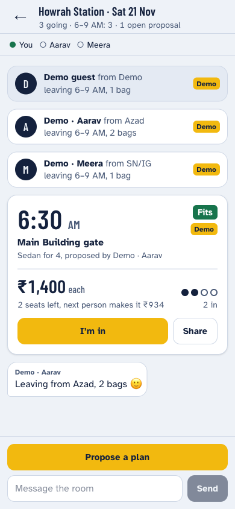
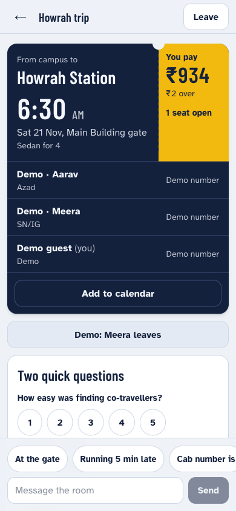

# Hop — split the ride home with KGP

**Live:** https://hop-kgp.vercel.app · **Track:** Social & Community · Built for the [Nexconn Build Challenge 2026](https://reskilll.com/hack/nexconn)

At the end of every semester, IIT Kharagpur students hunt for people to share a cab or toto to Howrah, Kolkata airport, Santragachi or Kharagpur station. Today that happens in buried WhatsApp posts that expose phone numbers and never show who has really committed.

Hop turns it into a chat that **ends in a decision**:

1. Post where and when you're going. You land in a room for that destination and day.
2. Someone proposes a plan (time, meeting point, vehicle, fare). The per-head fare drops on screen as people tap **I'm in**.
3. When at least two are in, anyone in can **lock** the trip. The room becomes a private pod with a **Trip Ticket**: phone numbers revealed, fare split, free seats still open. If someone joins or leaves, the fare re-splits in front of everyone.

| Lobby | Locked trip |
|---|---|
|  |  |

**Try it without a KGP account:** open the live link and tap **Try the demo**. You get a sandbox lobby with two labelled demo travellers, and reach a locked trip in three taps. Demo accounts are server-flagged, kept out of real lobbies, and excluded from every public number (`/stats`).

## Nexconn SDK features used

| Feature | Where | Why |
|---|---|---|
| Init, connect, token auth (`NCEngine.initialize`, `connect`) | [`web/src/client/nexconn.ts`](web/src/client/nexconn.ts) (client), [`web/src/server/nexconn/api.ts`](web/src/server/nexconn/api.ts) `issueToken` + [`web/src/app/api/nexconn/token/route.ts`](web/src/app/api/nexconn/token/route.ts) | Tokens are issued server-side; the App Secret never reaches the browser |
| Signed Platform API requests (SHA1 signature, backup-host failover) | [`web/src/server/nexconn/sign.ts`](web/src/server/nexconn/sign.ts), [`api.ts`](web/src/server/nexconn/api.ts) | Server-to-Nexconn calls |
| Group channels created and managed by the server (`/v4/group-channel/create`, `join`, `leave`) | [`api.ts`](web/src/server/nexconn/api.ts), [`lobbies.ts`](web/src/server/lobbies.ts), [`pods.ts`](web/src/server/pods.ts) | One lobby per destination and day; one private pod per locked trip |
| Custom message types `Hop:Intent`, `Hop:Proposal`, `Hop:Ticket` (`registerCustomMessages`) | [`nexconn.ts`](web/src/client/nexconn.ts), [`web/src/domain/cards.ts`](web/src/domain/cards.ts), [`web/src/components/cards.tsx`](web/src/components/cards.tsx) | Plans, trip cards and tickets are structured cards, not free text |
| Message metadata, set by the server and received live (`/v4/channel-type/message/metadata/set`, `onMessageMetadataUpdated`) | [`web/src/server/mirror.ts`](web/src/server/mirror.ts), [`nexconn.ts`](web/src/client/nexconn.ts) | Votes, seat counts and lock state update on every phone without a reload |
| Read receipts (`needReceipt`, `sendReadReceiptResponse`, `createMessagesReadReceiptUsersQuery`) | [`nexconn.ts`](web/src/client/nexconn.ts), [`web/src/app/pod/[podId]/page.tsx`](web/src/app/pod/[podId]/page.tsx) | "Seen by N" in each pod |
| Online status (`userModule.subscribeEvent`, `UserHandler`) | [`nexconn.ts`](web/src/client/nexconn.ts), lobby page | Presence dots for people in the room |
| Message history (`createMessagesQuery`) and live receive (`MessageHandler`) | [`nexconn.ts`](web/src/client/nexconn.ts) | Lobby and pod chat |
| Connection status and kick handling (`ConnectionStatusHandler`, code 31010) | [`nexconn.ts`](web/src/client/nexconn.ts), [`web/src/components/ConnectionBanner.tsx`](web/src/components/ConnectionBanner.tsx) | Reconnect and "opened on another device" states |
| Pre-messaging webhook (`group_channel:pre_messaging`, signature check) | [`web/src/server/webhook.ts`](web/src/server/webhook.ts), [`web/src/app/api/webhooks/nexconn/route.ts`](web/src/app/api/webhooks/nexconn/route.ts) | Blocks phone numbers typed into a lobby; numbers are only shared after a lock |

Web is the platform. We built our own mobile-first UI on `@nexconn/chat` 26.2.1 (pinned) because ChatUI does not support portrait phone browsers or metadata cards.

## Architecture

```
 phone / browser (Next.js, @nexconn/chat)
   │  REST (session cookie)                    │ WebSocket (Nexconn token)
   ▼                                           ▼
 Next.js route handlers on Vercel  ──signed──▶  Nexconn Platform API (Singapore)
   │   token, intents, proposals, vote/lock         ▲ pre-messaging webhook
   ▼                                                │
 Postgres (Supabase, Mumbai): trips, votes, pods ───┘
```

Postgres is the source of truth. Seat caps, one vote per lobby and the lock are enforced by atomic SQL functions ([`web/db/migrations/0002_state_machine.sql`](web/db/migrations/0002_state_machine.sql)); Nexconn messages and metadata are the live mirror the apps render.

## Run it

```bash
cd web
cp .env.example .env.local   # fill in your own keys
pnpm install
pnpm db:migrate
pnpm dev
pnpm test                    # 128 tests: state machine, fares, tokens, webhook, privacy, demo isolation
```

Needs a Nexconn app (Singapore data centre), a Supabase project with Google and anonymous sign-in, and a Google OAuth client. Never commit `.env.local`.

## Privacy and safety

- Sign-in is Google restricted to `@kgpian.iitkgp.ac.in`. The demo uses temporary guest accounts.
- Phone numbers are hidden until a trip locks, then shown only to members of that trip. The public share page shows counts and times only.
- Hop never holds money or onboards drivers; the fare split is a calculation.
- Policies: [`/privacy`](https://hop-kgp.vercel.app/privacy), [`/terms`](https://hop-kgp.vercel.app/terms).

## What is new

Everything in this repository was built during the Nexconn Build Challenge (19–22 Nov 2026). No code pre-dates it.

## Licence

MIT. See [LICENSE](LICENSE).
